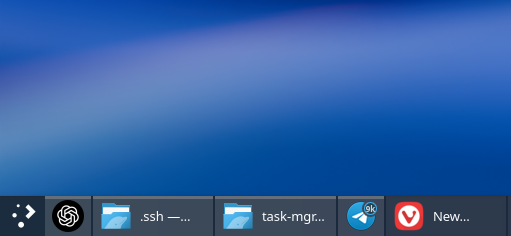

# Hybrid Task Manager

[English](README.md) | Polski

Wariant KDE **Icons-and-Text Task Manager** z wyborem aplikacji wyświetlanych samą ikoną. Bazuje na kodzie Plasma Desktop **6.8.0** i używa istniejącego modelu zadań KDE.



Kliknij prawym przyciskiem zadanie na pasku i zaznacz **Pokazuj tylko ikonę tej aplikacji** (po angielsku: **Show Only Icon for This Application**). Odznaczenie przywraca tekst. Przycisk bez tekstu zajmuje mniej miejsca. Wybór dotyczy wszystkich okien aplikacji i wszystkich instancji tego widżetu, także po ponownym uruchomieniu aplikacji lub Plasmy. Nazwy w podpowiedziach i listach okien pozostają dostępne.

Aplikację rozpoznaje wpis `.desktop` zwracany przez KDE, a gdy go brakuje — App ID / WM_CLASS. Nie trzeba wpisywać ścieżki programu, nazwy okna ani PID-u. Flatpaki korzystają ze swojego identyfikatora `.desktop`. Dla okien bez rozpoznawalnego identyfikatora opcja jest nieaktywna.

## Wymagania

Widżet zawiera plugin C++ i wymaga kompilacji ze źródeł. Potrzebne są:

- Kompilator C++20, CMake 3.22 lub nowszy, Ninja i gettext.
- Qt 6.10 lub nowsze, KDE Frameworks 6 oraz Extra CMake Modules 6.20 lub nowsze.
- Biblioteki deweloperskie Plasmy, w tym PlasmaQuick, PlasmaActivities, PlasmaActivitiesStats, KSysGuard i LibNotificationManager.
- Python 3.9 lub nowszy, KWin (`kwin_wayland`), LayerShellQt i D-Bus (`dbus-run-session`) do skryptów instalacji i testów.
- systemd z poleceniami `systemctl` i `busctl` do automatycznej aktywacji na panelu.

Przetestowano z Plasmą **6.8.0**, KDE Frameworks **6.31** i Qt **6.12** na Garuda Linux. Inne wersje mogą wymagać zmian w kodzie lub konfiguracji kompilacji.

## Instalacja

Uruchom poniższe polecenie z katalogu projektu jako zwykły użytkownik:

```bash
bash scripts/install.sh --activate
```

Skrypt buduje i testuje widżet, instaluje go w `~/.local`, robi kopię konfiguracji paneli i zastępuje wszystkie istniejące widżety **Icons-and-Text Task Manager**, zachowując ich ID, pozycje oraz ustawienia. Po zainstalowaniu zależności sama instalacja widżetu nie wymaga uprawnień roota.

Automatyczna aktywacja wymaga istniejącego widżetu Icons-and-Text Task Manager (lub wcześniej aktywowanego Hybrid Task Manager) na panelu oraz usługi użytkownika systemd `plasma-plasmashell.service`. Jeśli panel zawiera tylko menedżer zadań z samymi ikonami, przed aktywacją dodaj standardowy menedżer z ikonami i tekstem. Jeśli Plasma została uruchomiona ręcznie, aktywacja zamknie tę powłokę przed uruchomieniem jej przez usługę.

Aktywacja na krótko restartuje powłokę Plasmy; KWin i uruchomione aplikacje pozostają aktywne. Ponowne wykonanie polecenia aktualizuje bibliotekę i przeładowuje widżet. Pomiń `--activate`, aby zbudować, przetestować i zainstalować widżet bez zmiany konfiguracji paneli i restartu Plasmy.

## Restart Plasmy i przywracanie brakującego widżetu

Do restartowania Plasmy używaj usługi użytkownika systemd:

```bash
systemctl --user restart plasma-plasmashell.service
```

Aktywacja zapisuje `QT_PLUGIN_PATH` w konfiguracji tej usługi, aby Plasma mogła znaleźć lokalnie zainstalowany plugin. Uruchomienie `plasmashell` bezpośrednio lub przez `kstart` pomija tę konfigurację i może powodować błąd **package org.ezez.plasma.hybridtaskmanager does not exist**, mimo że plugin nadal jest zainstalowany. Powyższego polecenia używaj również we własnych skryptach restartu.

Jeśli Plasma już działa poza usługą, wykonaj w katalogu projektu poniższe polecenie, aby przywrócić widżet bez ponownej kompilacji ani usuwania go z panelu:

```bash
python3 scripts/panel.py activate
```

Skrypt zamyka ręcznie uruchomioną powłokę, czeka na jej zakończenie i zapis układu paneli, a następnie uruchamia usługę ze ścieżką do pluginu. Jeśli powłoka nie zakończy się w ciągu dziesięciu sekund, aktywacja przerywa działanie przed zmianą układu. Błąd startu powoduje próbę przywrócenia poprzedniej konfiguracji; komunikat nieudanej aktywacji zawiera lokalizację kopii zapasowej.

## Sprawdzanie stanu i cofnięcie zmiany

```bash
python3 scripts/panel.py status
python3 scripts/panel.py restore
```

`restore` przywraca standardowy menedżer w tych samych miejscach. Nie odtwarza całego starego układu pulpitu, więc późniejsze zmiany w innych widżetach zostają zachowane.

## Konfiguracja i aktualizacje

Domyślne lokalizacje plików:

- Biblioteka: `~/.local/lib/qt6/plugins/plasma/applets/org.ezez.plasma.hybridtaskmanager.so`.
- Wybór aplikacji: `~/.config/hybridtaskmanagerrc`, grupa `Appearance`, klucz `IconOnlyApplications`.
- Ścieżka do lokalnego pluginu dla Plasmy: `~/.config/systemd/user/plasma-plasmashell.service.d/50-hybrid-taskmanager.conf`.
- Kopie konfiguracji: `~/.local/state/hybrid-taskmanager/`.

Aktualizacja pakietów KDE nie nadpisuje tego widżetu. Po zmianach ABI Plasmy lub Qt może być potrzebna ponowna kompilacja. Zmiany z przyszłych wersji menedżera zadań KDE nie trafiają do tego forka automatycznie.

### Po aktualizacji Plasmy

Jeśli na panelu zamiast widżetu widać ikonę, a po kliknięciu pojawia się **Could not load plugin … libPlasma.so.N: cannot open shared object file**, biblioteka została zbudowana dla poprzedniej wersji Plasmy. Przebuduj ją i przeładuj:

```bash
bash scripts/install.sh --activate
```

Nowe wydanie Plasmy może też zmienić API, z których korzysta widżet. Wtedy kompilacja się nie powiedzie albo widżet nadal się nie załaduje. W takim przypadku zostanie wydana zaktualizowana wersja projektu. Zaktualizuj swoją kopię projektu i ponownie uruchom powyższe polecenie.

### Aplikacje webowe Chromium

Pod Waylandem model zadań Plasmy może pokazywać aplikacje webowe (PWA) przeglądarek opartych na Chromium jako samą przeglądarkę: z jej ikoną i nazwą oraz w jednej grupie z jej oknami. Dotyczy to również standardowych menedżerów zadań KDE. Dzieje się tak, gdy plik `.desktop` przeglądarki deklaruje `StartupWMClass` (np. `StartupWMClass=chromium` od Chromium 154 w Arch Linux), ponieważ każde okno przeglądarki, także aplikacji webowej, zgłasza Plasmie nazwę pliku wykonywalnego.

`scripts/install.sh` uruchamia `scripts/chromium-pwa.py`, który kopiuje takie wpisy przeglądarek do `~/.local/share/applications/` bez `StartupWMClass`. Okna samej przeglądarki są nadal rozpoznawane po identyfikatorze aplikacji. Kopie powstają tylko dla przeglądarek z zainstalowanymi aplikacjami webowymi, są oznaczone kluczem `X-HybridTaskManager-Source` i nigdy nie zastępują Twoich własnych plików. Plasma uwzględnia zmianę bez restartu.

Po zainstalowaniu aplikacji webowej lub aktualizacji przeglądarki uruchom skrypt ponownie, aby odświeżyć kopie. Aby je usunąć:

```bash
python3 scripts/chromium-pwa.py restore
```

## Testy

Aby zbudować i uruchomić testy bez instalowania widżetu:

```bash
cmake -S . -B build -G Ninja -DCMAKE_BUILD_TYPE=RelWithDebInfo
cmake --build build -j 2
ctest --test-dir build --output-on-failure
bash scripts/test-integration.sh
```

Testy obejmują identyfikację aplikacji, trwały zapis ustawień, akcje menu kontekstowego, etykiety, szerokości przycisków, ponowne otwarcie aplikacji, pionowe panele, wiele rzędów, grupowanie i współdzielenie ustawień między instancjami. Testy przeciągania sprawdzają drobne ruchy kursora, zatrzymanie i celową zmianę kierunku w układach LTR i RTL.

Testy aktywacji obejmują odzyskiwanie widżetu po ręcznym restarcie Plasmy, przekroczenie czasu zamykania powłoki i przywracanie konfiguracji po nieudanym starcie. Korzystają z plików tymczasowych, symulowanych odpowiedzi usługi i jednorazowych procesów, bez sterowania sesją pulpitu. Testy skryptu dla aplikacji webowych Chromium korzystają z tymczasowych katalogów aplikacji.

Testy integracyjne ładują rzeczywisty plugin Plasmy i model okien jako sesję zagnieżdżonego KWin z wirtualnym wyjściem i renderowaniem programowym, ponieważ Plasma 6.8 śledzi okna wyłącznie pod Waylandem. Prywatna sesja D-Bus oraz tymczasowe katalogi konfiguracji, danych, uruchomieniowe i pamięci podręcznej izolują je od sesji pulpitu. Testy nie łączą się z ekranem użytkownika.

Logi i zrzuty ekranu powstają w `artifacts/`. Ostrzeżenia o niedostępnych usługach aktywności KDE, bazie ostatnich dokumentów lub popupach z przechwytywaniem wejścia (menu kontekstowe są otwierane programowo, bez interakcji użytkownika) są spodziewane w izolowanej sesji testowej.

Skrypt testowy zgłasza niepowodzenie przy błędach asercji, komunikatach QML `TypeError`/`ReferenceError` i pętlach powiązań właściwości.

## Pochodzenie kodu i licencje

`src/` pochodzi z `applets/taskmanager` projektu [KDE plasma-desktop, tag v6.8.0](https://invent.kde.org/plasma/plasma-desktop/-/tree/v6.8.0/applets/taskmanager). Pliki konfiguracji historii aktywności pochodzą z `kcms/recentFiles`. Warunki licencyjne określają nagłówki SPDX poszczególnych plików i teksty w [LICENSES/](LICENSES/). Tłumaczenia standardowych funkcji korzystają z oryginalnego katalogu tłumaczeń KDE.
