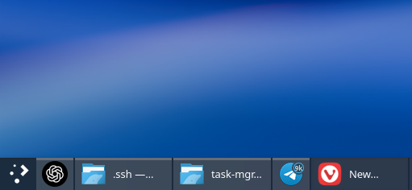

# Hybrid Task Manager

English | [Polski](README-pl.md)

A fork of KDE's **Icons-and-Text Task Manager** that lets you display selected applications as icons without labels. Based on Plasma Desktop **6.8.0**, using KDE's existing task model.



Right-click an application's task button and enable **Show Only Icon for This Application**. Disable it to restore the label. The icon-only button takes up less space. Your choice applies to all windows of that application and every instance of this widget, and survives application and Plasma restarts. Window names remain available in tooltips and window lists.

Applications are identified by the `.desktop` entry supplied by KDE, falling back to App ID / WM_CLASS when no entry is available. There is no need to enter executable paths, window titles, or process IDs. Flatpak applications use their `.desktop` identifiers. The option is disabled for windows without a usable application identifier.

## Requirements

This widget includes a C++ plugin and must be built from source. It requires:

- A C++20 compiler, CMake 3.22 or newer, Ninja, and gettext.
- Qt 6.10 or newer, KDE Frameworks 6, and Extra CMake Modules 6.20 or newer.
- Plasma development libraries, including PlasmaQuick, PlasmaActivities, PlasmaActivitiesStats, KSysGuard, and LibNotificationManager.
- Python 3.9 or newer, KWin (`kwin_wayland`), LayerShellQt, and D-Bus (`dbus-run-session`) for the installation and test scripts.
- systemd with `systemctl` and `busctl` for automatic panel activation.

Tested with Plasma **6.8.0**, KDE Frameworks **6.31**, and Qt **6.12** on Garuda Linux. Other versions may require changes to the code or build configuration.

## Installation

Run the following from the project directory as your regular user:

```bash
bash scripts/install.sh --activate
```

The script builds and tests the widget, installs it under `~/.local`, backs up the panel configuration, and replaces all existing **Icons-and-Text Task Manager** widgets while preserving their IDs, positions, and settings. Installation does not require root privileges once the dependencies are available.

Automatic activation requires an existing Icons-and-Text Task Manager (or a previously activated Hybrid Task Manager) on a panel and the systemd user service `plasma-plasmashell.service`. If the panel only has an Icons-Only Task Manager, add the standard Icons-and-Text Task Manager before activating this widget. If Plasma was started manually, activation closes that shell before starting it through the service.

Activation briefly restarts the Plasma shell; KWin and running applications remain active. Running the command again updates the library and reloads the widget. Omit `--activate` to build, test, and install without changing the panel configuration or restarting Plasma.

## Restarting Plasma and recovering a missing widget

Use the systemd user service to restart Plasma:

```bash
systemctl --user restart plasma-plasmashell.service
```

Activation configures `QT_PLUGIN_PATH` in an override for this service so Plasma can find the locally installed plugin. Starting `plasmashell` directly or through `kstart` bypasses that override and can produce **package org.ezez.plasma.hybridtaskmanager does not exist**, even though the plugin is still installed. Use the command above in custom restart scripts as well.

If Plasma is already running outside the service, run this from the project directory to recover without rebuilding or removing the widget:

```bash
python3 scripts/panel.py activate
```

The script stops the manually started shell, waits for it to exit and save the panel layout, and starts the service with the plugin path. If the shell does not exit within ten seconds, activation stops before modifying the layout. Startup failures trigger an attempt to restore the previous configuration; the error includes the backup location if activation cannot complete.

## Status and rollback

```bash
python3 scripts/panel.py status
python3 scripts/panel.py restore
```

`restore` switches the widgets back to KDE's standard task manager in the same positions. It preserves subsequent changes to other widgets instead of restoring the entire desktop layout from a backup.

## Configuration and updates

Default file locations:

- Plugin library: `~/.local/lib/qt6/plugins/plasma/applets/org.ezez.plasma.hybridtaskmanager.so`.
- Application preferences: `~/.config/hybridtaskmanagerrc`, group `Appearance`, key `IconOnlyApplications`.
- Local plugin path for Plasma: `~/.config/systemd/user/plasma-plasmashell.service.d/50-hybrid-taskmanager.conf`.
- Configuration backups: `~/.local/state/hybrid-taskmanager/`.

KDE package updates do not overwrite this widget. Plasma or Qt ABI changes may require rebuilding it. This fork does not automatically incorporate changes from future versions of KDE's task manager.

### After a Plasma upgrade

If the panel shows an icon instead of the widget and clicking it reports **Could not load plugin … libPlasma.so.N: cannot open shared object file**, the library was built against the previous Plasma version. Rebuild and reload it:

```bash
bash scripts/install.sh --activate
```

A new Plasma feature release can also change the APIs this widget uses, so rebuilding fails or the widget still does not load. In that case, an updated version of the project will be released. Update your copy of the project and run the command above again.

### Chromium web apps

On Wayland, Plasma's task model can show Chromium-based web apps (PWAs) as the browser itself: with the browser's icon and name, and grouped with its windows. This affects KDE's standard task managers as well. It happens when the browser's `.desktop` entry declares `StartupWMClass` (e.g. `StartupWMClass=chromium` since Chromium 154 on Arch Linux), because every window of the browser, including web apps, reports the executable name to Plasma.

`scripts/install.sh` runs `scripts/chromium-pwa.py`, which copies such browser entries to `~/.local/share/applications/` without `StartupWMClass`. The browser's own windows are still recognized by their app ID. Overrides are created only for browsers that have web apps installed, marked with `X-HybridTaskManager-Source`, and never replace your own files. Plasma picks up the change without a restart.

Run the script again after installing a web app or updating the browser to refresh the copies, and remove the overrides with:

```bash
python3 scripts/chromium-pwa.py restore
```

## Tests

To build and run the tests without installing the widget:

```bash
cmake -S . -B build -G Ninja -DCMAKE_BUILD_TYPE=RelWithDebInfo
cmake --build build -j 2
ctest --test-dir build --output-on-failure
bash scripts/test-integration.sh
```

Tests cover application identification, preference persistence, context-menu actions, labels, button widths, reopening applications, vertical panels, multiple rows, grouping, and sharing preferences between widget instances. Drag-and-drop tests check small pointer movements, pauses, and intentional reversal in both LTR and RTL layouts.

Activation tests cover recovery after a manual Plasma restart, shutdown timeouts, and restoring the configuration after a failed startup. They use temporary files, simulated service responses, and disposable processes without controlling the desktop session. Tests of the Chromium web app script use temporary application directories.

Integration tests load the actual Plasma plugin and window model as the session of a nested KWin with a virtual output and software rendering, since Plasma 6.8 tracks windows only on Wayland. A private D-Bus session and temporary configuration, data, runtime, and cache directories isolate them from the desktop session. They do not connect to the user's display.

Logs and screenshots are written to `artifacts/`. Warnings about unavailable KDE activity services, the recent-documents database, or grabbing popups (context menus are opened programmatically, without user input) are expected in the isolated test session.

The test runner fails on assertion failures, QML `TypeError`/`ReferenceError` messages, and binding loops.

## Source and licensing

`src/` is derived from `applets/taskmanager` in [KDE plasma-desktop, tag v6.8.0](https://invent.kde.org/plasma/plasma-desktop/-/tree/v6.8.0/applets/taskmanager). The activity-history configuration files come from `kcms/recentFiles`. See each file's SPDX header and the license texts in [LICENSES/](LICENSES/) for licensing terms. Translations for standard task-manager features use KDE's original translation catalog.
